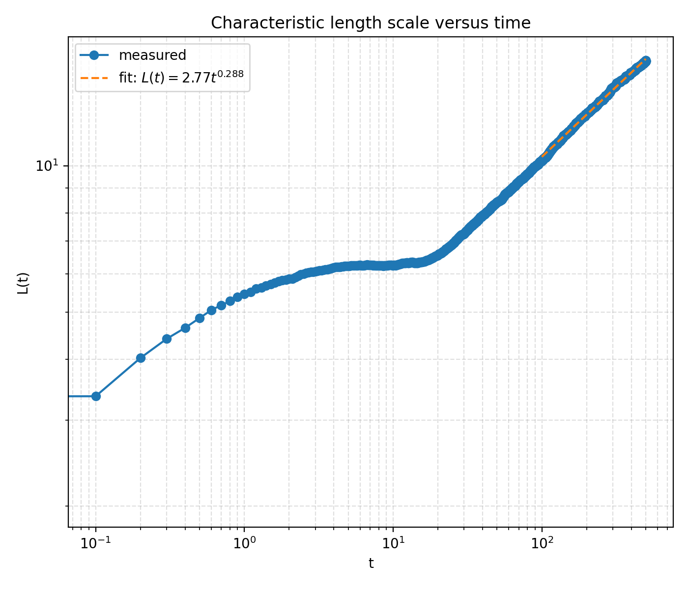
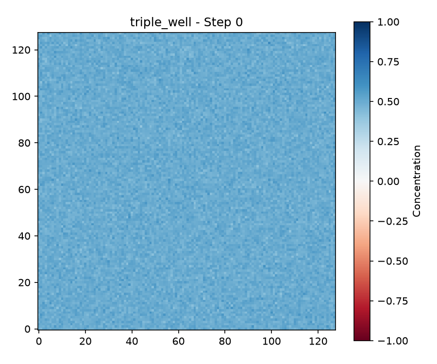
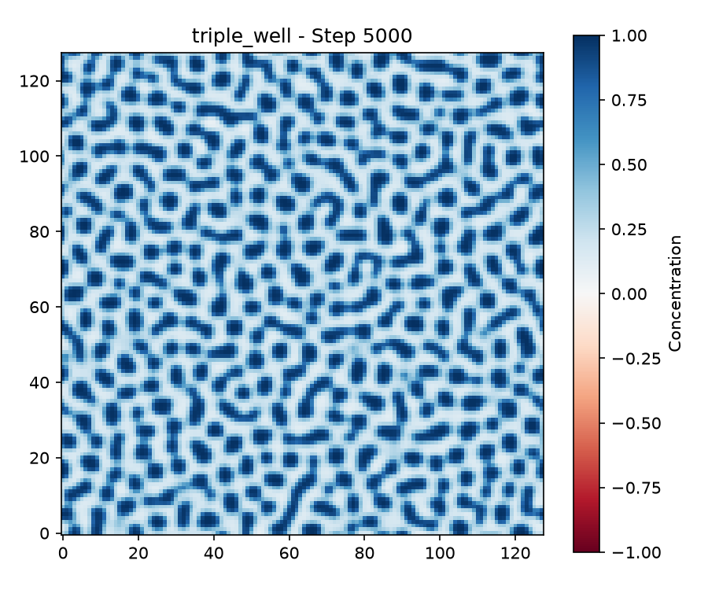
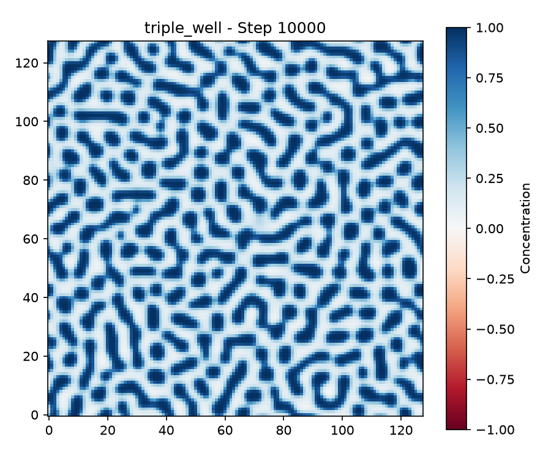

Group report

# Cahn-Hilliard phase separation in 2D

We simulate spinodal decomposition of a binary mixture with the Cahn-Hilliard equation on a periodic N x N grid (N = 128, dx = 1):

    dc/dt = M * Laplace(mu),    mu = f'(c) - kappa * Laplace(c),    f(c) = (c^2 - 1)^2 / 4

with M = kappa = 1 and an explicit Euler step. A well-mixed state inside the unstable region is not stable, so it separates into domains in the minima of f (c = +1 and c = -1 for the standard double well), and the domains then coarsen. The task description is in `README.md`. The four tasks are:

1. **Task 1:** time evolution from a random start, snapshots every 500 steps, plus a constant start and a single-node start.
2. **Task 2:** check mass conservation, m(t) = m(0), and energy dissipation, dF/dt <= 0.
3. **Task 3:** measure a length scale L(t), and fit L = A t^alpha for t > 100.
4. **Task 4:** replace the free energy density (asymmetric double well, Flory-Huggins, triple well, double well with external field, periodic) and look at the patterns.

All numbers and figures below come from runs of the code in this repository. Task 1-3 files are unchanged from the previous version of the repository (only the folders were renamed to `Task_2` and `Task_3`), so their results are unchanged as well.

## Layout of the algorithm, functions to be created

    Scripts/Task_1/laplacian.py
    def laplacian(u, dx):
        # 5-point Laplacian with periodic boundaries (np.roll)
        # input : 2D array u, spacing dx ; output: 2D array, same shape

    Scripts/Task_1/do_time_step.py
    def do_time_step(c, dx, dt, M, kappa):
        # mu = c**3 - c - kappa*laplacian(c);  c += dt*M*laplacian(mu)
        # input : c (N x N), dx, dt, M, kappa
        # output: c, updated IN PLACE (the same array is also returned)

    Scripts/Task_2/calculate_mass.py
    def calc_mass(c):
        # returns np.sum(c)   (equals the integral for dx = 1)

    Scripts/Task_2/calculate_free_energy.py
    def free_energy(c, kappa, dx=1.0):
        # local density (c^2-1)^2/4 + kappa/2 * |grad c|^2, forward differences
        # output: N x N array; total F = np.sum(...) * dx**2

    Scripts/Task_3/main_T3.py
    def defining_length(grid, spacing=1.0):
        # counts sign changes of c along every row and column;
        # L = mean spacing between sign changes (lines without any change are skipped)
        # input : 2D array ; output: L (float) or nan
    def fit_growth_exponent(times, lengths, min_time=100.0):
        # least-squares line through log L vs log t for t > min_time
        # output: (alpha, A)
    def run_simulation():
        # random start, 50000 steps (t = 500), L measured every 10 steps
        # output: (times, lengths)

    Scripts/Task_4/free_energy_T4.py
    def df_dc(c, potential, parameter=1.0):
        # derivative f'(c) of the selected free energy
        # potential: "asymmetric" | "flory_huggins" | "triple_well" | "external_field" | "periodic"
        # parameter: alpha, chi or H (ignored by "triple_well" and "periodic")
        # flory_huggins clips c to [1e-8, 1-1e-8] inside the logarithm only
        # output: array like c ; unknown name -> ValueError

    Scripts/Task_4/do_time_step_T4.py
    def do_time_step_T4(c, dx, dt, M, kappa, potential, parameter=1.0):
        # same step as do_time_step, but mu = df_dc(c, potential, parameter) - kappa*laplacian(c)
        # output: c, updated IN PLACE

    Scripts/Task_4/main_T4.py
        # runs ONE potential (the string `potential` at the top), prints min/max/mean of c
        # and stores snapshots every `plot_every` steps in Scripts/Task_4/snapshots/

Because a time step changes the field in place, snapshots must be stored with `c.copy()` (the scripts do this).

The f'(c) implemented in Task 4:

| `potential` | f(c) | f'(c) | parameter |
|---|---|---|---|
| (standard, Task 1) | (c^2-1)^2/4 | c^3 - c | none |
| `asymmetric` | (c^2-1)^2/4 + alpha c | c^3 - c + alpha | alpha |
| `flory_huggins` | c ln c + (1-c) ln(1-c) + chi c(1-c) | ln(c/(1-c)) + chi (1-2c) | chi |
| `triple_well` | (c+1)^2 c^2 (c-1)^2 | 2c(c^2-1)(3c^2-1) | none |
| `external_field` | (c^2-1)^2/4 - H c | c^3 - c - H | H |
| `periodic` | 1 - cos(c) | sin(c) | none |

## How to run the code

Run from the repository root:

    python3 Scripts/Task_1/main_T1.py        # animation, writes Scripts/Task_1/task_1_animation.gif
    python3 Scripts/Task_2/main_T2.py        # mass and free-energy plot (needs the fix in Problems 1)
    python3 Scripts/Task_3/main_T3.py        # L(t), fit, writes Scripts/Task_3/task_3_length_scale.png
    python3 Scripts/Task_4/main_T4.py        # one potential, writes Scripts/Task_4/snapshots/
    python3 -m pytest Scripts/Task_3         # unit tests

There are no command line arguments; the parameters are set at the top of each script. Scripts 1 and 2 open a matplotlib window; on a machine without a display use `MPLBACKEND=Agg python3 ...`.

| Parameter | Meaning | Value |
|---|---|---|
| `N`, `dx` | grid size, spacing | 128, 1.0 |
| `M`, `kappa` | mobility, interface coefficient | 1.0, 1.0 |
| `dt` | time step | 0.01 (Tasks 1-3), 0.001 (Task 4) |
| `steps` | Task 1 and 2 scripts as committed | 5000 (the task asks for 10000, see Problems 2) |
| `steps` | Task 3 | 50000 (t = 500), `sample_every` = 10 |
| `steps`, `plot_every` | Task 4 | 10000 (t = 10), 2500 |
| `potential`, `parameter` | Task 4, as committed | `"triple_well"`, 1.0 (`parameter` = alpha, chi or H for the other potentials) |

The Task 1 initial condition is chosen by uncommenting a line in `main_T1.py`: random noise `0.05*np.random.randn(N,N)` (default), a single seed `c[N//2,N//2] = 1`, or a constant `c.fill(0.5)`. In Task 4 the initial field is `0.5 + 0.02*randn + 0.02*randn` with `np.random.seed(42)`. To try another potential, change the string `potential` (and `parameter`) in `main_T4.py`.

## Resulting files

| File | Format | Meaning |
|---|---|---|
| `Scripts/Task_1/task_1_animation.gif` | GIF, 5 fps | the stored Task 1 snapshots played back |
| `Scripts/Task_3/task_3_length_scale.png` | PNG | log-log plot of L(t) of one run with its fit |
| `Scripts/Task_4/snapshots/<potential>_step_<k>.png` | PNG, 150 dpi | concentration field at steps 0, 2500, 5000, 7500, 10000 (committed: `triple_well`); colour range fixed to -1...1 |
| `figures/*.png` | PNG | the figures used in this report |
| `figures/metrics_t12.txt`, `metrics_t3.txt`, `metrics_t4.txt` | text | numbers quoted in this report |
| `Scripts/Task_4/run_all_potentials_report.py` | Python | helper that runs all five potentials with the repository's `do_time_step_T4` and `df_dc` and writes the Task 4 figures of this report |

## Successful tests

- `python3 -m pytest Scripts/Task_3`: **2 passed**.
  - `test_defining_length_checkerboard`: the +1/-1 checkerboard has a sign change at every neighbouring pair (7 per line), so L = 8/7.
  - `test_fit_growth_exponent`: synthetic data L = 2 t^0.5 gives alpha = 0.5 and A = 2 (relative tolerance 1e-6).
- Mass conservation (Task 2): over 10000 steps the total mass changes by at most 3.7e-13 (see Results).
- Energy dissipation (Task 2): F decreases in every one of the 10000 steps (no step with dF > 0).
- Constant start (Task 1): c = 0.5 stays at 0.5 exactly (maximum deviation 0.0 after 10000 steps), as it must because the Laplacian of a constant field vanishes.
- Single-node start (Task 1): the field stays exactly symmetric about the seed (max asymmetry 0.0), and its mass stays at 1.000000.
- Task 4, the checks that are commented out in `free_energy_T4.py` and `do_time_step_T4.py` (we ran them):
  - `df_dc` at c = -1, 0, 1: asymmetric gives (1, 1, 1) for alpha = 1; external field gives (-1, -1, -1) for H = 1; periodic gives sin(c) = (-0.8415, 0, 0.8415); triple well gives 0 at all three points, i.e. the three minima of f.
  - One `do_time_step_T4` step with the triple well changes the mean concentration by 1.6e-19 (mass conserved).
- Task 4, all runs (committed set-up and the extended runs): the fields stay finite, and the mass is conserved to the printed precision (see tables).
- Task 4, committed run reproduced: running `main_T4.py` unchanged gives the same patterns as the committed `snapshots/*.png`; the printed range at step 10000 is 0.0197...1.0055 and the mean stays at 0.49995.

## Problems

maybe da es paar problem erwähne wo mer kah händ

## Results (speed tests etc.)

### Task 1: time evolution

Random start `0.05*randn`, numpy seed 0, 10000 steps (t = 100).

| Step 0 | Step 10000 |
|---|---|
|  |  |

The noise (|c| < 0.2) grows into a labyrinth of domains, and the domains coarsen. At t = 100 the field lies between -1.02 and 1.04, and the + and - phases each occupy about 50% of the area (50.2% of the nodes have c > 0). The montage shows 6 of the 21 frames stored every 500 steps; the animation `Scripts/Task_1/task_1_animation.gif` holds the stored frames.

**Constant start (c = 0.5):** nothing happens. The Laplacian of a constant field is zero, so mu is constant and dc/dt = 0 (maximum deviation 0.0 after 10000 steps). A constant field is a stationary solution, even though it is unstable against perturbations.

**Single node (c = 1 at the centre, 0 elsewhere):** the field does not stay localized. It spreads from the seed and forms concentric rings with a wavelength of about 9 grid units (2 pi sqrt(2 kappa), the fastest-growing mode); the rings expand until they fill the box and meet their periodic images at t ~ 100. The total mass stays 1.000000, and the field stays exactly symmetric about the seed. A single node contains all Fourier modes with equal weight, including the unstable ones (the fastest-growing mode has a rate of 1/(4 kappa) = 0.25), so the seed acts as a broadband perturbation of the unstable c = 0 state and keeps its isotropic symmetry.

### Task 2: mass and free energy

| Quantity | Value |
|---|---|
| m(0) | -4.711068 |
| max abs(m(t) - m(0)) over 10000 steps | 3.7e-13 (rounding error) |
| F(0) | 4155.9 |
| F(t = 1) / F(10) / F(50) | 4094.9 / 4047.8 / 2836.1 |
| F(t = 100) | 2309.5 |
| steps with F increasing | 0 of 10000 |

Mass is conserved to rounding precision and F only decreases. F falls quickly during the first steps because the grid-scale noise is smoothed, stays almost flat during t ~ 1-12 while the linear instability grows, and then drops steeply when the domains form (t ~ 12-25). After that the decay is slow, as the interface length shrinks during coarsening.

### Task 3: characteristic length

Five runs (numpy seeds 0-4) of 50000 steps (t = 500) with the committed `run_simulation` and `fit_growth_exponent` (fit for t > 100).

| Quantity | Value |
|---|---|
| L(t = 1) / L(10) / L(100) / L(500) (mean of 5 runs) | 5.43 / 6.25 / 10.32 / 17.40 |
| alpha, five single runs | 0.326, 0.332, 0.341, 0.316, 0.334 |
| alpha, mean +- std of the five runs | 0.330 +- 0.010 |
| alpha, fit of the averaged L(t) | 0.330 |
| A, fit of the averaged L(t) | 2.25 |
| alpha for other fit windows (t > 50 / 200 / 300) | 0.324 / 0.329 / 0.324 |
| Theory (conserved dynamics, Lifshitz-Slyozov) | 1/3 |

L(t) increases with time. After a short initial growth, there is a plateau for t ~ 2-15, which is the linear stage where the fastest-growing wavelength is selected and only the amplitude grows. Once the domains have formed (t > 20), L grows as a power law. The measured exponent 0.33 +- 0.01 agrees with the expected 1/3. The speed was 1.2-1.9 ms per time step for N = 128 (two runs in parallel on two cores of a cloud container).

### Task 4: other free-energy densities

All Task 4 runs use the repository functions `do_time_step_T4` and `df_dc` unchanged; N = 128, M = kappa = 1.

#### 4.1 The committed run: triple well, c0 = 0.5 + noise, dt = 0.001, t = 10

| Step 0 | Step 5000 | Step 10000 |
|---|---|---|
|  |  |  |

(the snapshots at steps 2500 and 7500 are in `Scripts/Task_4/snapshots/`.) The value c = 0.5 lies in the unstable region of the triple well (f'' = -2.1, growth rate about 1.1 per time unit), so the noise grows quickly, and by t = 5 the field has split into dark droplets of c ~ 1 in a light matrix of c ~ 0 and then coarsens. The minimum rises from 0.25 (step 2500) to 0.07 (step 5000) and 0.02 (step 10000), the maximum is 1.005, and the mean stays at 0.49995. Only two of the three phases (0 and +1) appear, see Problems 4. There is no phase at c = -1 because the mean of 0.5 does not allow it.

#### 4.2 The other potentials with the committed set-up (only `potential` changed)

Same initial field (seed 42), dt = 0.001, 10000 steps (t = 10).

| `potential`, parameter | min c | max c | what is seen at t = 10 |
|---|---|---|---|
| `triple_well` | 0.020 | 1.005 | separated into c ~ 0 and c ~ 1 (4.1) |
| `flory_huggins`, chi = 2.5 | 0.284 | 0.697 | pattern starts to form, not yet separated (figure below) |
| `asymmetric`, alpha = 1 | 0.477 | 0.520 | nothing visible yet |
| `external_field`, H = 1 | 0.477 | 0.520 | nothing visible yet, identical numbers to `asymmetric` |
| `periodic` | 0.494 | 0.507 | nothing: c = 0.5 is stable, noise decays |

The mean is 0.5000 and the mass 8191.2335 in all five runs. The time scales follow from the linear growth rate sigma = f''(c0)^2 / (4 kappa) at c0 = 0.5: 0.016 for the double well (f'' = -0.25, factor e^0.16 = 1.2 by t = 10, therefore nothing visible), 0.25 for Flory-Huggins with chi = 2.5 (f'' = -1, factor e^2.5 = 12) and 1.1 for the triple well (f'' = -2.1). The periodic potential has f'' = cos(0.5) > 0, so there is no instability.

So for four of the five potentials, the committed set-up shows too little. The next section therefore runs longer (t = 100, dt = 0.01 unless noted) with a start suited to each potential.

#### 4.3 Extended runs to t = 100

| Run | Potential, parameter | Start | dt, steps | Final min / max | Final mass |
|---|---|---|---|---|---|
| reference | `external_field`, H = 0 (= standard) | 0.05 noise | 0.01, 10000 | -1.013 / 1.017 | -7.9478 |
| asym | `asymmetric`, alpha = 1 | same noise | 0.01, 10000 | -1.013 / 1.017 | -7.9478 |
| field | `external_field`, H = 1 | same noise | 0.01, 10000 | -1.013 / 1.017 | -7.9478 |
| mean03 | standard | 0.3 + 0.05 noise | 0.01, 10000 | -1.030 / 0.975 | 4907.25 |
| flory | `flory_huggins`, chi = 2.5 | 0.5 + 0.05 noise | 0.01, 10000 | 0.134 / 0.865 | 8184.05 |
| triple | `triple_well` | random 8 x 8 blocks in [-1, 1] | 0.005, 20000 | -1.011 / 1.012 | 243.37 |
| periodic | `periodic` | random 8 x 8 blocks in [-2 pi, 2 pi] | 0.01, 10000 | -6.43 / 6.49 | -2581.40 |

In every run the final mass equals the initial mass to the printed precision.

**Reference (standard double well):**

**Asymmetric double well, alpha = 1, and external field, H = 1: identical to the reference.**

With the same initial noise the difference to the reference at t = 100 is at most 3.7e-13 (alpha = 1) and 1.6e-13 (H = 1), which is rounding error. The reason is given in Problems 7: a linear term only shifts mu by a constant, and the dynamics only sees Laplace(mu). What does shift the composition is the **mean of the initial field**, because it fixes the mass. This is shown next, with the standard free energy and an initial mean of 0.3:

The + phase now fills 69% of the nodes (c > 0), and the minority - phase forms droplets in a connected + matrix. (The lever rule for phases at +-1 predicts 65%; the pixel count includes the interfaces.)

**Flory-Huggins, chi = 2.5:**

The mixture separates into two phases. The final field lies between 0.134 and 0.865, close to the coexistence (binodal) compositions c = 0.145 and 0.855 for chi = 2.5 (solution of ln(c/(1-c)) = chi (2c-1)); the spinodal points are 0.276 and 0.724, and the mixture at c = 0.5 is unstable for chi > 2. The structure is labyrinthine because the mean is 0.5.

**Triple well, block start:**

Now all three phases appear: the middle phase c = 0 forms the background, and droplets of c = +1 and c = -1 sit in it. Final range -1.011...1.012. The droplets coarsen and become round.

**Periodic potential, block start:**

There are infinitely many wells at c = 2 pi n; with this start, the values separate into c ~ 0 as background and droplets near c = +-2 pi (final range -6.43...6.49; the overshoot beyond 2 pi is in the interfaces). So it behaves like the triple well, with outer phases that are 2 pi apart. Neighbouring droplets of +2 pi and -2 pi are separated by the c = 0 phase.

## Sources and notes

- Task description: `README.md` of this repository (original Cahn-Hilliard model and variants).
- The first Task 1 script is based on `images/README.md`.
- The corrected `Scripts/Task_2/calculate_free_energy.py` and the helper `Scripts/Task_4/run_all_potentials_report.py` were written for this report and are not yet in your repository.

## AI Declaration
A variety of AI Agents such as Claude and Copilot were used to assist with writing the code as well as this report.
